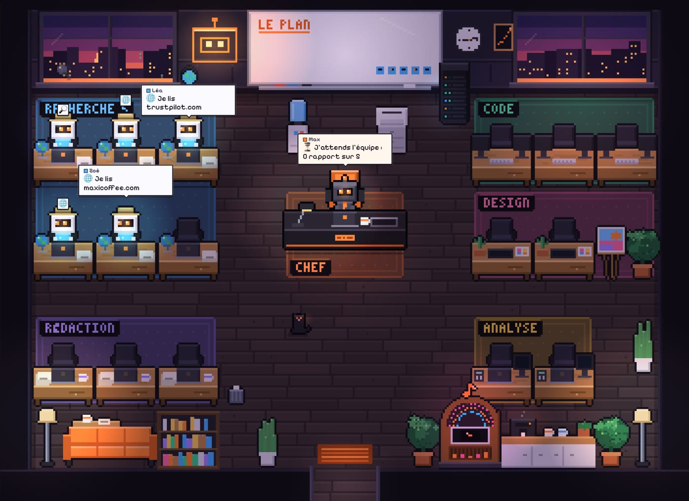

# Le Bureau des agents : suivi en direct

Un bureau en pixel art pour **suivre en direct tes sessions Claude Code**, sur ton ordinateur. Chaque session est une
salle : Max, le chef, c'est l'agent principal ; chaque sous-agent est un robot qui entre, s'assoit, montre son action en
cours dans une bulle, puis repart une fois son travail rendu. Le tableau de la salle affiche le plan.



Ce projet part du [Bureau des agents](https://github.com/devlikemasta/bureau-des-agents) de **devlikemasta / VibesMoney**
(licence MIT) : le moteur pixel art, les meubles, les robots et la musique viennent de là. Cette version lit **tes vraies
sessions** (app desktop, terminal, worktrees), en lecture seule : elle ne lance rien, elle regarde.

Trois pages :

- **Bureau** : le bandeau du jour (tâches finies, coût, cumul des jetons), « À toi de jouer » (les sessions qui attendent
  ta réponse), puis une carte par session en cours ou finie depuis moins de 12 h. Clique une carte pour entrer dans la salle.
- **Réalisations** : une entrée par session terminée (résumé, ce qui a été fait, fichiers livrés, captures), classée par
  sujet. Gardé 30 jours.
- **Rapports** : tes études longues (fichiers `.md`), rangées par sujet, avec une page de lecture, un PDF et un résumé audio.

Les prix affichés sont en **équivalent tarif API** : sur abonnement, ce n'est pas ce que tu paies, c'est ce que ça
coûterait à l'API (table unique : `shared/pricing.ts`).

## Prérequis

- macOS ou Linux.
- Node.js 22.18 ou plus récent (`node -v`, sinon https://nodejs.org, version LTS).
- git, et Claude Code déjà utilisé sur cette machine : le bureau lit `~/.claude/projects`.

## Installer

1. Sur GitHub, clique **Use this template** pour créer ta propre copie de ce dépôt (ou fais un fork).
2. Récupère-la et lance le bureau :

```bash
gh repo clone <TON_COMPTE>/bureau-des-agents
cd bureau-des-agents
npm run local
```

(Sans la commande `gh` : `git clone https://github.com/<TON_COMPTE>/bureau-des-agents.git`.)

`npm run local` installe ce qui manque (la première fois, environ 1 min), construit le bureau, lance un serveur local
sur **http://127.0.0.1:8790**, lance le collecteur de tes sessions et ouvre le navigateur déjà connecté. Le lien de
connexion est aussi affiché dans le terminal. Laisse le terminal ouvert ; Ctrl+C arrête tout. Aucun compte Cloudflare
n'est nécessaire : tout reste sur ta machine.

Tu préfères que Claude s'en charge : colle-lui le message de [docs/message-pour-ton-claude.md](docs/message-pour-ton-claude.md).

## Réglages utiles

Les options se mettent après `--`, les variables devant la commande :

- `npm run local -- --port 8791` si le port 8790 est pris ; `-- --no-open` pour ne pas ouvrir le navigateur.
- `npm run local -- --rapports ~/mes-rapports` : le dossier des rapports (voir plus bas).
- `BUREAU_WINDOW_H=72 npm run local` : remonter 72 h en arrière au lieu de 24.
- `CLAUDE_PROJECTS_DIR=<dossier>/projects` si tu utilises un autre dossier de configuration Claude (`CLAUDE_CONFIG_DIR`).
- `BUREAU_SOURCE_LABEL="Mon portable"` : le nom de ta machine sur l'étage.
- `BUREAU_AI_SUMMARY=0` : sinon, si la commande `claude` est connectée, le collecteur résume tes demandes et tes
  réalisations avec Claude Haiku (`claude -p`, sur ton abonnement).
- `BUREAU_TOTAL_SINCE=2026-01-01` : le point de départ du cumul des jetons (30 derniers jours par défaut).
- PDF des rapports : le collecteur les imprime avec Chromium (`npx playwright-core install chromium-headless-shell`, une
  fois) ; sans lui, le bouton PDF photographie la page.
- Résumé audio des rapports : la voix du Mac (`say`) et `ffmpeg` (`brew install ffmpeg`) ; sans eux, pas de bouton Écouter.

## Les rapports

Un rapport est un fichier `.md` rangé dans `<dossier>/<sujet>/` (deux niveaux au plus) qui commence par un en-tête :

```markdown
---
rapport: Comparatif des outils de prise de notes
sujet: Veille
niveau: a-lire
resume: Trois outils testés, un gagnant clair pour ton usage.
date: 2026-11-25
---

Le texte du rapport, en Markdown. Les images citées () sont publiées avec lui.
```

`niveau` vaut `a-lire` (en tête de liste), `reference` (rangé par sujet) ou `trace` (directement dans les archives,
c'est aussi le cas sans niveau). Demande à tes agents d'écrire leurs études ainsi dans ce dossier : elles apparaissent
dans l'onglet Rapports en quelques minutes.

## Où sont les données

- Les salles, le fil et les rapports publiés : `worker/.wrangler/state`.
- Les caches du collecteur (fil des réalisations, résumés) : `~/.config/bureau-collector`.
- Les secrets locaux (mot de passe, jeton, créés tout seuls) : `worker/.dev.vars`.

Rien de cela n'est versionné. Le bureau n'écoute que sur 127.0.0.1 : personne d'autre sur ton réseau ne le voit. Le
collecteur n'envoie que des résumés caviardés (jamais un prompt complet, une commande complète, un chemin avec ton nom
d'utilisateur ni un secret).

## L'adapter

- **Les catégories des réalisations** : `FeedCategory` et `CATEGORY_LABELS` dans `shared/live.ts`, les mots-clés de
  secours (`CATS`) et la consigne de résumé (`DIGEST_SYSTEM`) dans `collector/feed.ts`, les sous-groupes dans
  `shared/subgroups.ts`, les couleurs (`.cat-dot.<clé>`) dans `src/styles.css`.
- **Les prompts** des résumés : `collector/summarize.ts` (tes demandes), `collector/feed.ts` (les réalisations),
  `collector/reportAudio.ts` (le résumé audio et le lexique de prononciation).
- **Les noms et les métiers** des robots : `shared/activity.ts`.
- **La musique** du jukebox : les fichiers de `public/music/` et leur liste dans `src/audio/music.ts` (seulement des
  morceaux que tu as le droit d'utiliser).
- **Les thèmes** (clair, sombre) et la palette : `src/styles.css` et `src/engine/pixels.ts`.

Les règles du code sont dans [CLAUDE.md](CLAUDE.md) : Claude Code les lit avant de modifier le bureau. Avant de valider
un changement : `npm run check` (les types) et `npm run build`.

## En ligne (facultatif)

Pour suivre tes sessions depuis une tablette ou plusieurs machines, le même Worker se déploie sur ton propre compte
Cloudflare (offre gratuite) :

1. Dans `worker/wrangler.toml`, mets ton `account_id` (ou laisse `npx wrangler login` le trouver) et, si tu veux, ton
   domaine dans `routes`. Sans domaine, l'adresse est `https://bureau-des-agents.<ton-sous-domaine>.workers.dev`.
2. Crée le bucket R2 privé et déploie :

```bash
npm install && npm run build
cd worker && npm install
npx wrangler r2 bucket create bureau-des-agents-media
npx wrangler deploy
npx wrangler secret put INGEST_TOKEN      # le jeton du collecteur (une longue chaîne au hasard)
npx wrangler secret put SESSION_SECRET    # la signature du cookie (une autre chaîne au hasard)
npx wrangler secret put ACCESS_PASSWORD   # le mot de passe du site
```

3. Sur chaque Mac à suivre, le collecteur en tâche de fond :

```bash
mkdir -p ~/.config/bureau-collector && echo "INGEST_TOKEN=<le jeton>" > ~/.config/bureau-collector/secrets.env
chmod 600 ~/.config/bureau-collector/secrets.env
bash scripts/install-collector.sh https://bureau-des-agents.<ton-sous-domaine>.workers.dev "Mon Mac"
```

Le script crée le LaunchAgent `com.bureau-des-agents.collector` (démarre avec ta session, redémarre s'il s'arrête).
Journal : `~/Library/Logs/bureau-collector/collector.log`. Désinstaller : `bash scripts/install-collector.sh --uninstall`.
Tester sans rien envoyer : `node collector/index.ts --dry --once`. Sous Linux, lance `node collector/index.ts` avec
`BUREAU_URL` et `BUREAU_TOKEN` dans un service de ton choix (systemd par exemple).

## Le bureau d'origine

`npm start` lance toujours le bureau d'origine : Max et une équipe de sous-agents que le bureau lance lui-même sur une
mission. Son mode d'emploi complet est dans [docs/README-original.md](docs/README-original.md).

## Crédits

- **Le Bureau des agents** d'origine : [devlikemasta/bureau-des-agents](https://github.com/devlikemasta/bureau-des-agents),
  par [VibesMoney](https://vibesmoney.com), licence MIT (voir [LICENSE](LICENSE)).
- **La musique** : morceaux originaux du bureau d'origine ([ElevenLabs Music](https://elevenlabs.io/music) et Google Lyria).
